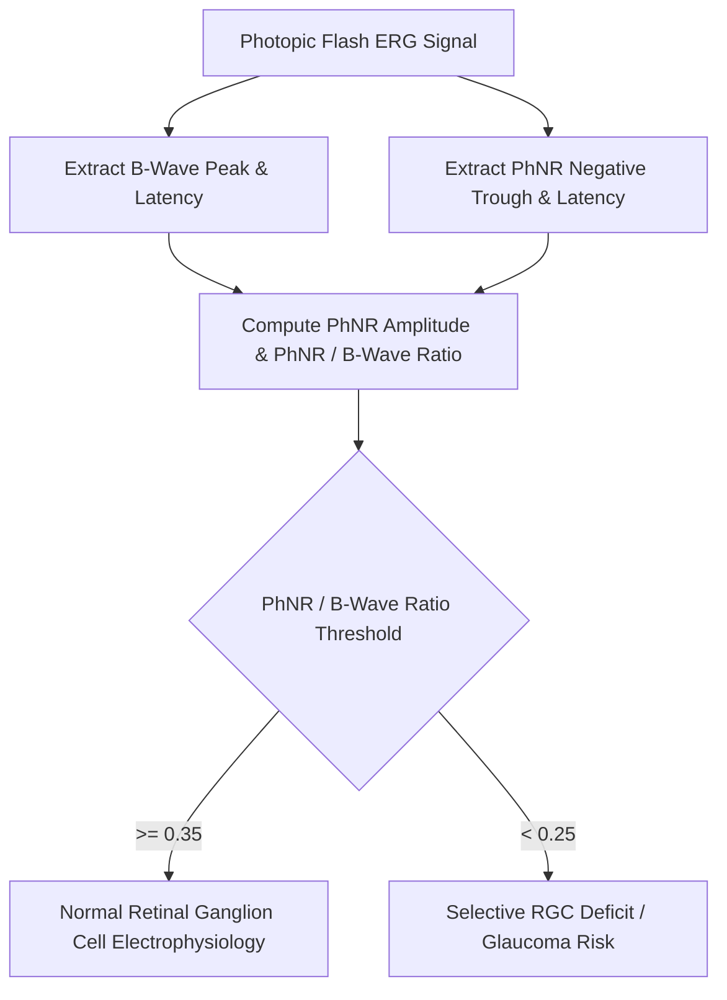

# Ocular Photopic Negative Response (PhNR) Skill

[](LICENSE)
[](https://www.python.org/)
[](https://openclaw.org/)
[](https://alphapark.ai/)
[](https://modelcontextprotocol.io/)

Photopic Negative Response (PhNR) and Retinal Ganglion Cell Electrophysiological Analyzer based on full-field flash ERG biophysics.



## Features
- **Zero PIP Dependencies**: Implemented strictly with Python Standard Library (`math`, `json`, `sys`, `typing`).
- **Inner Retinal Specificity**: Selectively indexes retinal ganglion cell soma and axonal bio-signals.
- **Normalized Ratio Calculation**: PhNR/b-wave metric resists confounding from cataracts or pupil constriction.
- **Dual Architecture**: Native Python import and Model Context Protocol (MCP) JSON-RPC 2.0 stdio server.

## Quickstart
```bash
python example_usage.py
```

## License
Apache-2.0
